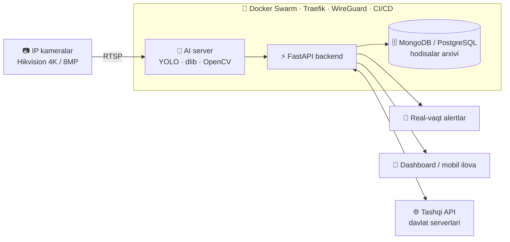

<div align="center">


<a href="https://git.io/typing-svg"></a>

[](https://t.me/KhayitovDev)
[](https://linkedin.com/in/khayitovdev)
[](mailto:khayitovdev@gmail.com)


</div>

---

## 🧭 Men haqimda

**5+ yillik tajribaga ega Backend va AI/Computer Vision muhandisiman.** Asosiy yo'nalishim — kamera asosidagi intellektual nazorat tizimlari: yuz tanish, avtoraqam tanish, forma va xavfsizlik qoidalarini nazorat qilish, taqiqlangan zonalar monitoringi.

Tizimni boshidan oxirigacha o'zim olib chiqaman: **kamera va tarmoqni sozlash → dataset yig'ish va model o'qitish → real-vaqt video oqimini qayta ishlash → backend va API → Docker Swarm'da production deploy.**

Loyihalarim prezentatsiyada emas — **real hayotda ishlayapti**: universitet auditoriyalarida, respublika bo'ylab texnik ko'rik punktlarida, kimyo sanoati korxonasida, lombard tarmog'ida va o'nlab maktablarda.

```python
class KhayitovJavokhir:
    role       = "Backend / AI Computer Vision Engineer"
    current    = "Software Engineer @ INNOVA"
    location   = "Tashkent, Uzbekistan 🇺🇿"
    experience = "5+ years (since 2021)"
    expertise  = ["Face Recognition", "License Plate Recognition (ANPR)",
                  "PPE / Uniform Detection", "Real-time RTSP Video Analytics",
                  "High-load APIs", "Microservices", "DevOps"]
    languages  = {"Uzbek": "native", "English": "B1", "Russian": "A2"}

    def motto(self):
        return "Ishlaydigan tizim > chiroyli slayd"
```

---

## 📊 Raqamlarda

<div align="center">

| 🎓 Yuz tanish | 🚗 Raqam tanish | 🏫 Davomat tarmog'i | 📷 Kameralar |
|:---:|:---:|:---:|:---:|
| **10,000+** talaba | **100+** nazorat punkti | **30+** maktab | **130+** 4K kamera |
| real-vaqt identifikatsiya | butun respublika bo'ylab | WireGuard VPN orqali | bitta universitetda |

</div>

---

## 🧠 AI / Computer Vision bo'yicha nimalar qila olaman

<table>
<tr>
<td width="50%" valign="top">

**👤 Yuz tanish (Face Recognition)**
- Yuzni aniqlash, embedding olish, bazadagi shaxs bilan solishtirish
- Xodim / begona shaxsni real vaqtda ajratish
- Ko'p kamerali muhitda shaxsni kuzatish va joylashuvini aniqlash

</td>
<td width="50%" valign="top">

**🚗 Avtoraqam tanish (ANPR / LPR)**
- Raqam belgisini aniqlash va o'qish
- Davlat serverlari bilan integratsiya va tekshiruv
- Transport turi va kirish-chiqishni qayd etish

</td>
</tr>
<tr>
<td width="50%" valign="top">

**🦺 Forma va xavfsizlik nazorati (PPE)**
- Maxsus kiyim / forma kiyilganini tekshirish
- Taqiqlangan zonaga kirishni aniqlash
- Xulq-atvor tahlili: uxlash, telefon ishlatish, kayfiyat

</td>
<td width="50%" valign="top">

**📡 Real-vaqt video analitika**
- Hikvision IP kameralardan RTSP oqimlarini parallel qayta ishlash
- Hodisalarni avtomatik arxivlash va real-vaqt alertlar
- Custom dataset yig'ish, belgilash va YOLO modelini o'qitish

</td>
</tr>
</table>

### ⚙️ Tizimlarimning umumiy arxitekturasi



---

## 🚀 Production'dagi AI loyihalar

### 🎓 Universitet uchun AI yuz tanish va monitoring tizimi
> Yuridik universitet · **10,000+ talaba · 130+ 4K kamera**

- Har bir talabani kameralar orqali **real vaqtda** aniqlaydi va ma'lumotni mobil ilovaga yuboradi
- Davomatni to'liq avtomatik yuritadi — qo'lda yo'qlama kerak emas
- Darsdagi xulq-atvorni tahlil qiladi: **uxlash, telefon ishlatish, kayfiyat**
- Talaba **hozir qaysi bino va xonada** ekanini dars jadvalidagi **qayerda bo'lishi kerakligi** bilan solishtiradi
- 130+ yuqori aniqlikdagi kameradan keladigan oqimni bir vaqtda qayta ishlaydi

`FastAPI` `MongoDB` `YOLO` `dlib` `OpenCV` `Docker`

---

### 🚗 "Texnik ko'rik tizimi" — respublika miqyosidagi avtoraqam tanish
> O'zbekiston bo'ylab **100+ texnik ko'rik punkti**

- Har bir punktda **2 ta 4K kamera** orqali avtomobil raqamini AI bilan o'qiydi
- Respublika **YHXB (GAI) serveri** bilan solishtirib, ko'rikka **aynan ro'yxatdagi mashina** kelganini tasdiqlaydi
- Firibgarlikning oldini oladi: boshqa mashina bilan ko'rikdan o'tishning iloji yo'q
- Butun mamlakat bo'ylab tarqalgan punktlar yagona markazdan boshqariladi

`FastAPI` `YOLO` `OpenCV` `REST API` `PostgreSQL`

---

### 🛡️ AI video xavfsizlik va hodisalarga javob tizimi
> INNOVA · lombard tarmog'i uchun · **8MP Hikvision IP kameralar**

- Real-vaqt **RTSP oqimlarini** qayta ishlovchi FastAPI AI server
- Bitta tizimda: **yuz tanish, xodim/begona ajratish, forma nazorati, avtoraqam tanish, taqiqlangan zona monitoringi**
- Hodisalarni (xodim, begona shaxs, transport, zona buzilishi) avtomatik **rasm bilan arxivlash**
- Mas'ul xodimlarga **real-vaqt alertlar** va monitoring dashboard uchun API
- Docker Swarm'da production: **klasterlash, scaling, fault tolerance, load balancing, CI/CD**

`FastAPI` `RTSP` `YOLO` `OpenCV` `Hikvision` `Docker Swarm` `Traefik`

---

### 🏭 Sanoat xavfsizligi — shaxs va maxsus kiyim nazorati
> Navoiy Azot · **AI + Backend + DevOps — yakka o'zim**

- Korxona xodimlarini yuz orqali taniydi
- Maxsus kiyim (forma, himoya vositalari) talablariga rioya qilinishini **avtomatik nazorat qiladi**
- O'zim yig'gan va belgilagan **custom dataset** asosida o'qitilgan YOLO model
- Model o'qitishdan tortib serverga deploy qilishgacha butun tizimni bir o'zim qurganman

`YOLO` `custom dataset` `OpenCV` `FastAPI` `Docker`

---

### 🏫 30+ maktabni bog'lovchi yuz tanish davomat tarmog'i
> **30+ maktab · yagona markaziy server**

- Har bir maktabda **MikroTik** router → **WireGuard VPN** orqali markaziy serverga xavfsiz ulanish
- Yuz tanish terminallari API orqali yagona **FastAPI backend**'ga integratsiya qilingan
- Tarmoq, VPN, backend va integratsiyani to'liq loyihalash va ishga tushirish

`FastAPI` `WireGuard` `MikroTik` `PostgreSQL` `Linux`

---

### ⚡ Yuqori unumdorlikdagi yuz tanish API
> Next Developers Team LLC

- **Asinxron** rasm yuklash (aiohttp) va real-vaqt yuz tahlili
- dlib + OpenCV orqali yuzni aniqlash, feature extraction va **Euclidean distance** bo'yicha solishtirish
- Takroriy hisob-kitoblarni kamaytiruvchi **custom caching** mexanizmi
- Mustahkam xatoliklarni boshqarish bilan production-ready API

`FastAPI` `dlib` `OpenCV` `NumPy` `aiohttp` `Pydantic`

---

## 💼 Tajriba

```text
2026 ─ now    INNOVA                      Software Engineer
              └─ AI video xavfsizlik monitoring tizimi (8MP Hikvision IP kameralar):
                 yuz tanish, xodim/begona aniqlash, forma nazorati, raqam tanish,
                 taqiqlangan zona monitoringi
              └─ Real-vaqt RTSP oqimlarini qayta ishlovchi FastAPI AI server,
                 hodisalar arxivi, real-vaqt alertlar va dashboard API
              └─ Docker Swarm'da production: klasterlash, scaling, fault tolerance,
                 load balancing va CI/CD

2024 ─ 2026   Next Developers Team LLC    Software Engineer
              └─ Yuz tanish / image processing API (FastAPI, dlib, OpenCV, aiohttp)

2024          ViVa Med Uz                 Team Lead / Backend Engineer
              └─ Tibbiyot CRM uchun mikroservis arxitektura, backend jamoaga rahbarlik
                 (FastAPI, Django, Elasticsearch, Celery, Docker)

2023 ─ 2024   Boss Tracker Group          Backend Engineer
              └─ Ota-ona nazorati ilovasi, Payme / Click / Paynet integratsiyalari
                 (Django, DRF, Firebase, Celery)

2023          4DX IT Company              Backend Engineer
              └─ Tibbiyot CRM, SQL optimizatsiya (Django, Celery)

2022 ─ 2023   NetPro IT Company           Backend Developer
              └─ E-commerce backend, to'lov tizimlari, ombor avtomatizatsiyasi

2021 ─ 2022   Black Coders Uz             Python Developer
              └─ Django / DRF web ilovalar, PostgreSQL optimizatsiya
```

---

## 💻 Tech Stack

<div align="center">

**Backend**


**AI / Computer Vision**


**Ma'lumotlar bazasi va navbatlar**


**DevOps va infratuzilma**


</div>

---

## 📈 GitHub statistikasi

<div align="center">


</div>

---

## 🤝 Hamkorlik

Quyidagi yo'nalishlarda loyiha yoki ish takliflariga ochiqman:

- 🎥 Kamera + AI asosidagi nazorat va analitika tizimlari (yuz, raqam, forma, zona)
- ⚡ Yuqori yuklamali backend va mikroservislar
- 🐳 Server, Docker Swarm, CI/CD va tarmoq infratuzilmasini sozlash

<div align="center">

📫 **Bog'lanish:** [Telegram](https://t.me/KhayitovDev) · [LinkedIn](https://linkedin.com/in/khayitovdev) · [khayitovdev@gmail.com](mailto:khayitovdev@gmail.com)


</div>
